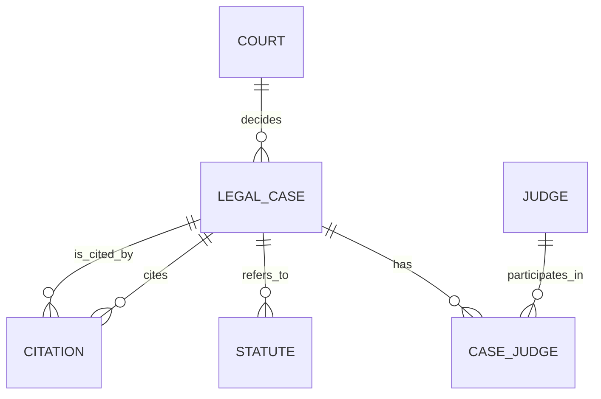

# Project Documentation — Legal Case Citation Evolution Analyzer

## 1. Problem statement
Lawyers and researchers need to know which precedents are gaining or losing influence. This system stores Indian courts, judges, cases, statutes and case-to-case citations, and analyses citation activity over configurable time windows to identify emerging, declining and frequently cited precedents.

## 2. Objectives
Model legal data relationally; track citation events over time; detect trends via time-window comparison; provide role-based web access.

## 3. Scope
In: cases, courts, judges, statutes, citations, trend analytics, auth (admin/analyst). Out: automatic parsing of judgments, real legal data ingestion. Data is fabricated.

## 4. Functional requirements
FR1 Login/logout with roles · FR2 Search cases (full-text, court, type filters) · FR3 Admin adds/edits/deletes cases · FR4 Admin records/deletes citations · FR5 Dashboard of emerging/declining/frequent precedents for 30/90/180/365-day windows · FR6 Per-case citation analysis (1/3/5-year windows, charts) · FR7 Landmark cases and court statistics.

## 5. ER diagram

(The team's hand-drawn ER diagram from the submission may be inserted here. Statute is a weak entity of Legal_Case; Citation is a self-relationship of Legal_Case, M:N resolved through the Citation table.)

## 6. Relational schema
- Court(**court_id**, court_name, court_level, location, established_year)
- Legal_Case(**case_id**, case_name, case_number, judgment_date, case_type, decision, citation_count, *court_id*)
- Judge(**judge_id**, judge_name, designation, appointed_date, retired_date)
- Case_Judge(***case_id, judge_id***, role_in_case)
- Statute(***case_id, statute_id***, act_name, section, description, enactment_year)
- Citation(**citation_id**, *citing_case_id*, *cited_case_id*, citation_date, context_text, page_number)
- App_User(**user_id**, username, password_hash, role) · Audit_Log(**log_id**, action, entity, entity_id, performed_at)

## 7. Database choice and justification
- **MySQL (SQL):** legal records are structured and highly relational (courts → cases → judges/statutes); need FK integrity, CHECK constraints, transactions, triggers.
- **MongoDB (NoSQL):** citation events grow continuously, carry flexible metadata (treatment, context, tags) and are queried by time window; aggregation pipelines ($match/$group/$cond/$facet) suit trend analysis without schema changes.
- Vector DB not used — no semantic-search requirement (optional item).

## 8. Data dictionary
See `db/schema.sql` (every column typed with constraints). Key rules: `Citation` UNIQUE(citing, cited), CHECK citing<>cited, page>0; `Legal_Case.citation_count>=0`; `Judge` retired>=appointed; `Court.court_level` ENUM.

**MongoDB `citation_events`:** `{citation_id, cited_case_id, citing_case_id, event_type, event_date, treatment, context:{text,page}, tags[]}`. Indexes: `{cited_case_id:1,event_date:-1}`, `{event_date:-1}`, `{treatment:1}`, `{citation_id:1}`. Retrieval: trend = group by `cited_case_id` counting events in recent window vs previous window; emerging if recent ≥ 2 and ≥ 1.5× previous; declining if previous ≥ 2 and recent ≤ 0.5× previous.

## 9. Implementation (files)
`db/schema.sql` (DDL, indexes, views) · `db/routines.sql` (procedure, function, triggers) · `db/demo_ddl.sql` (ALTER/DROP demo) · `db/queries.sql` · `scripts/seed.js`.

## 10. Advanced features (≥4 required; 7 implemented)
1. **Transaction + stored procedure** `sp_add_citation` (rollback on error)
2. **Triggers:** `trg_citation_bi` (rejects citing a later judgment / invalid date), `trg_citation_ai`/`ad` (maintain citation_count, write Audit_Log)
3. **Stored function** `fn_citations_between`
4. **Views** `Landmark_Cases`, `v_case_details`
5. **Indexes** incl. **full-text** `ft_case_text`
6. **MongoDB aggregation** (dashboard trends, per-case analysis with `$facet`)
7. **Transactional cascade delete** of a case with its citations

## 11. Data integrity & validation
DB-level: PK/FK, UNIQUE, NOT NULL, CHECK, ENUM, triggers, FK RESTRICT (a cited case cannot be deleted). App-level: server-side validation in each route handler before queries.

## 12. Security
bcrypt hashing; JWT in httpOnly/SameSite cookie; role checks in every write API; middleware blocks unauthenticated pages; parameterised queries (no SQL injection); secrets only in `.env.local`; login rate-limiting.

## 13. System architecture
Browser (Next.js React pages) → Next.js Route Handlers (auth, validation, RBAC) → MySQL (`mysql2` pool) and MongoDB (`mongodb` driver).

## 14. Test cases
| # | Test | Expected |
|---|---|---|
| 1 | Login admin/Admin@123 | Dashboard shown |
| 2 | Wrong password | "Invalid credentials" |
| 3 | Open /cases logged out | Redirect to /login |
| 4 | Analyst tries to add/delete (UI hidden; `curl` POST) | 403 Forbidden |
| 5 | Admin adds case with future date | 400 validation error |
| 6 | Admin adds citation where citing case is older than cited | Trigger error 400 |
| 7 | Add same citation pair twice | 409 duplicate |
| 8 | Add citation | cited case's `citation_count` +1 (trigger); Mongo event created |
| 9 | Delete a case (UI) | Case + its citations removed in one transaction; counts fixed. API without `cascade=1` returns 409 (FK RESTRICT) |
| 10 | Dashboard window 30 → 365 | Emerging/declining lists change |
| 11 | Full-text search "contract" | Matching cases listed |

## 15. Application screenshots
Insert screenshots of: login, dashboard, cases, timeline, citations, MySQL DDL output.

## 16. Conclusion & future work
Delivers SQL+NoSQL citation trend analysis. Future: semantic search over judgments using pgvector, real data import, citation network graph (Neo4j), charts.

## 17. Individual contributions (edit to match your commits)
- Divyadharshini: ER/schema, DDL, triggers/procedures, MySQL queries, documentation.
- Manasi: MongoDB model & aggregation, Next.js UI, auth/security, seed data, testing.
